# ShahiMovie

A movie, TV show, and artist browser built with React and the TMDB API.


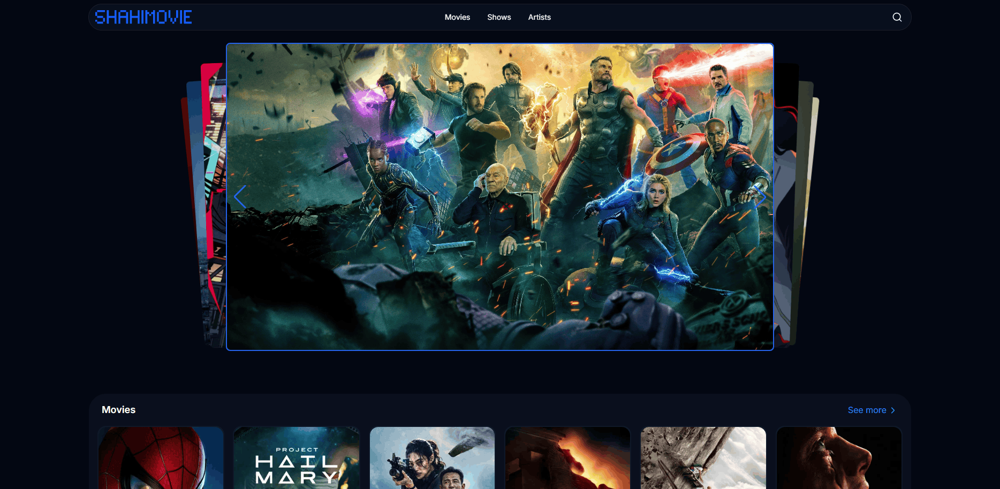
<!-- IMAGE: Full home page on desktop (hero slider on top, "Movies" section visible below it). Suggested size: 1600x900 (16:9). -->

**Live demo:** https://shahimovie.vercel.app

## Table of Contents

- [About](#about)
- [Features](#features)
- [Tech Stack](#tech-stack)
- [Getting Started](#getting-started)
  - [Prerequisites](#prerequisites)
  - [Installation](#installation)
  - [Environment Variables](#environment-variables)
  - [Running in development](#running-in-development)
  - [Building for production](#building-for-production)
- [Network Access](#network-access)
- [Project Structure](#project-structure)
- [Deployment](#deployment)
- [Contributing](#contributing)
- [License](#license)
- [Contact](#contact)

## About

ShahiMovie is a single-page website for finding movies, TV shows, and artists. Movie and TV data comes from the [TMDB API](https://www.themoviedb.org/documentation/api). Extra ratings (IMDb and Rotten Tomatoes) come from the [OMDb API](https://www.omdbapi.com/). The site uses a dark theme and works on mobile and desktop.

## Features

### Trending hero slider

The home page opens with a card-style slider of this week's top 10 trending movies and shows. It plays automatically and pauses when you hover over it. On large screens, hovering a slide shows the poster, title, and year. Each slide links to its details page.

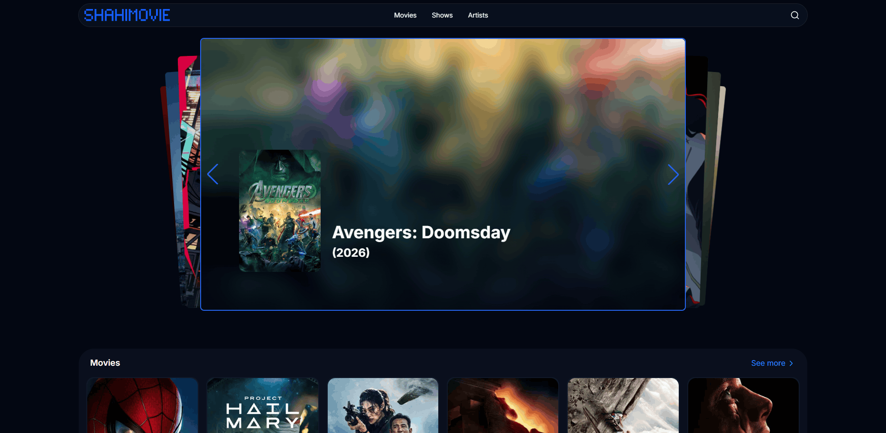
<!-- IMAGE: Close-up of the hero slider on desktop with the hover overlay visible (poster, title, year). Suggested size: 1600x900 (16:9). -->

### Home page sections

Below the slider, three sections show six popular items each: **Movies**, **TV Shows**, and **Artists**. Each section has a "See more" link to its full page. Loading placeholders show while data loads.

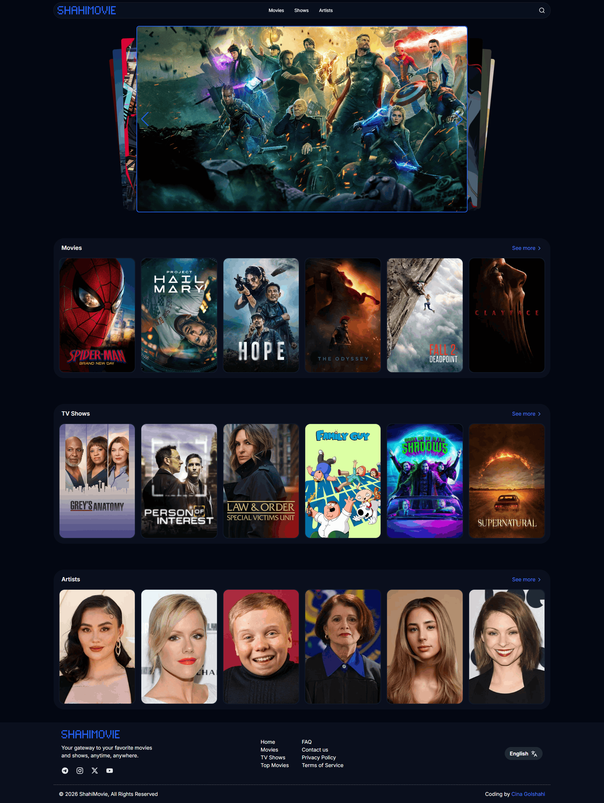
<!-- IMAGE: Home page scrolled down to show the Movies, TV Shows, and Artists sections. Suggested size: 1600x1200 (4:3). -->

### Browse movies and shows

The Movies and Shows pages list titles sorted by popularity. Only titles released up to today are shown. Use the "See More" button to load more pages of results.

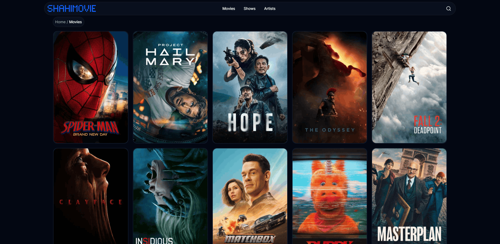
<!-- IMAGE: The /movies page with the breadcrumb and a grid of poster cards (one card in hover state). Suggested size: 1600x900 (16:9). -->

### Popular artists

The Artists page lists popular people with their photo, name, department, and the titles they are known for. It also has a "See More" button.

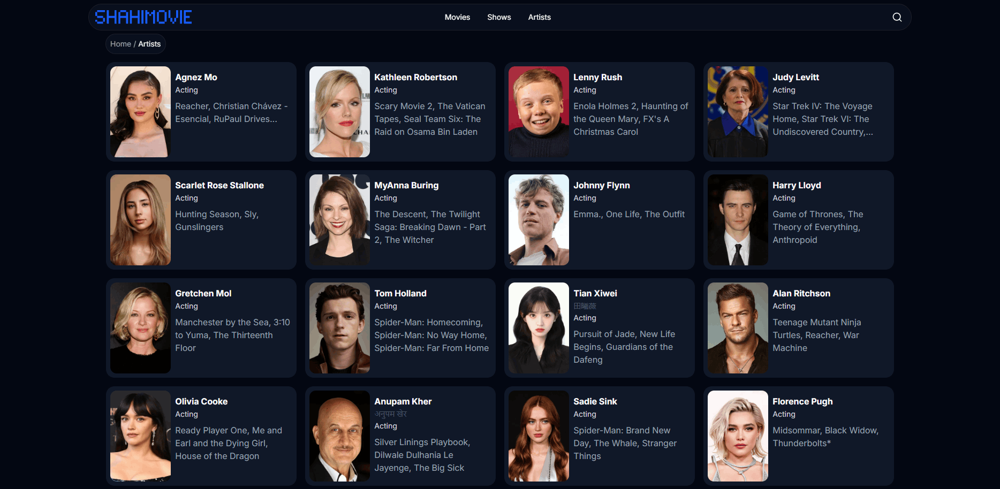
<!-- IMAGE: The /artists page showing a grid of wide artist cards. Suggested size: 1600x900 (16:9). -->

### Search

A search modal lets you type a query and see the top 3 matches (movies, shows, or people) after a short delay. Press Enter or click "Find more" to open the full results page at `/search/:search`, which lists movies and shows with a "See More" button.

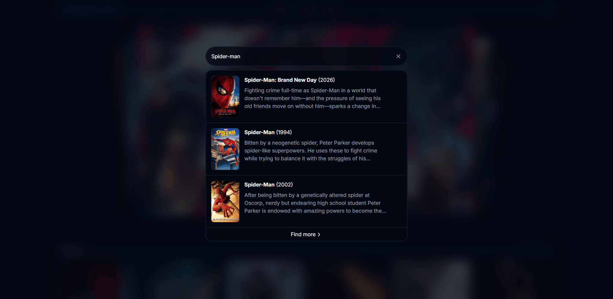
<!-- IMAGE: The search modal open with a query typed and 3 results plus the "Find more" link visible. Suggested size: 1600x900 (16:9). -->

### Movie details

Each movie page shows the poster, title, tagline, genres, year, runtime, countries, and overview. A rating bar shows scores from Rotten Tomatoes, IMDb, and TMDB. The first eight cast members are shown on large screens. Two tabs hold more information:

- **Details:** status, release date, runtime, director, countries, languages, budget, and collection.
- **Cast:** the full cast with character names.

The page ends with a recommendations section.

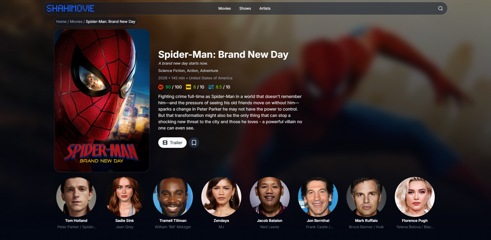
<!-- IMAGE: A movie details page (/movie/:id) showing the backdrop, poster, rating bar, and cast row. Suggested size: 1600x1000 (16:10). -->

### Show details

TV show pages show similar information plus the number of seasons and the show status. Three tabs are available:

- **Details:** status, first and last air date, creators, number of seasons and episodes, countries, and languages.
- **Seasons:** pick a season to see its episodes with still image, title, overview, runtime, air date, and a "Finale" badge.
- **Cast:** the aggregate cast with all roles per actor.

The page ends with a recommendations section.

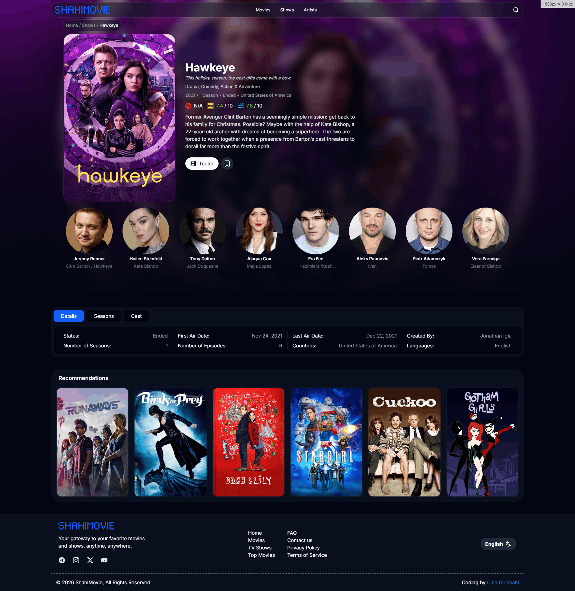
<!-- IMAGE: A TV show details page (/show/:id) with the Details tab open. Suggested size: 1600x1000 (16:10). -->

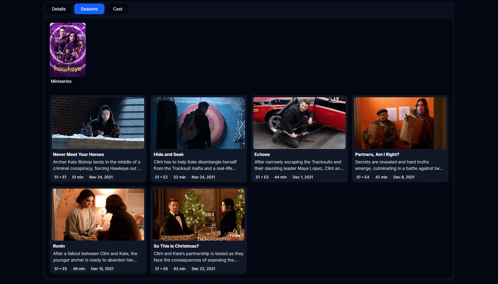
<!-- IMAGE: The Seasons tab of a show with a season selected and episode cards visible. Suggested size: 1600x900 (16:9). -->

### Artist details

Artist pages show the photo, name, department, birth date, birthplace, and biography. A "Known For" row lists up to 10 of the artist's most popular titles. Each one links to its movie or show page.

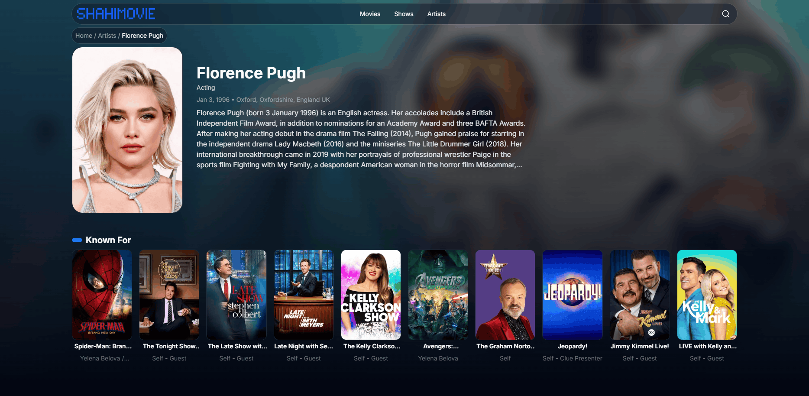
<!-- IMAGE: An artist details page (/artist/:id) with the biography and "Known For" row. Suggested size: 1600x1000 (16:10). -->

### Responsive layout

On mobile, a bottom navigation bar links to Home, Movies, Shows, and Artists. On desktop, a fixed header holds the logo. A "Page not found" screen appears for unknown routes.

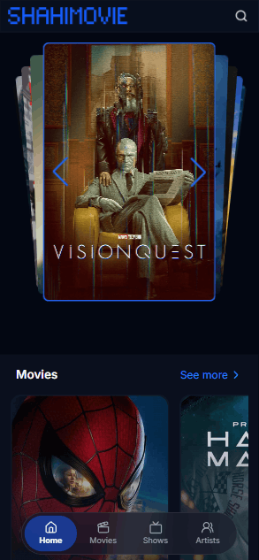
<!-- IMAGE: Mobile screenshots (home page and a details page) with the bottom navigation bar visible, side by side. Suggested size: 1200x1200 (1:1) or two 390x844 phone frames. -->

## Tech Stack

| Area         | Tools                                                                    |
| ------------ | ------------------------------------------------------------------------ |
| UI           | React 19, TypeScript                                                     |
| Build tool   | Vite 8                                                                   |
| Styling      | Tailwind CSS 4 (`@tailwindcss/vite`), Inter font (`@fontsource/inter`)   |
| Routing      | React Router DOM 7                                                       |
| HTTP         | Axios                                                                    |
| Slider       | Swiper                                                                   |
| Icons        | lucide-react, @thesvg/react                                              |
| Analytics    | @vercel/analytics                                                        |
| Code quality | ESLint, typescript-eslint, Prettier (with `prettier-plugin-tailwindcss`) |
| Data sources | TMDB API, OMDb API                                                       |

## Getting Started

### Prerequisites

- **Node.js** `^20.19.0` or `>=22.12.0` (required by Vite 8)
- **npm** (the project has a `package-lock.json`)
- A **TMDB API read access token** ([get one here](https://www.themoviedb.org/settings/api))
- An **OMDb API key** ([get one here](https://www.omdbapi.com/apikey.aspx))

### Installation

```bash
git clone https://github.com/CinaGolshahi/shahimovie.git
cd shahimovie
npm install
```

### Environment Variables

Create a `.env` file in the project root. This file is ignored by Git.

| Name                     | Description                                                     | Example value            |
| ------------------------ | --------------------------------------------------------------- | ------------------------ |
| `VITE_TMDB_ACCESS_TOKEN` | TMDB read access token. Sent as a Bearer token to the TMDB API. | `your_tmdb_access_token` |
| `VITE_OMDB_API_KEY`      | OMDb API key. Used to load IMDb and Rotten Tomatoes ratings.    | `your_omdb_api_key`      |

```env
VITE_TMDB_ACCESS_TOKEN=your_tmdb_access_token
VITE_OMDB_API_KEY=your_omdb_api_key
```

### Running in development

```bash
npm run dev
```

Vite prints the local address in the terminal. Open it in your browser.

### Building for production

```bash
npm run build
```

This runs the TypeScript build (`tsc -b`) and then `vite build`. The output goes to `dist/`. To check the production build locally:

```bash
npm run preview
```

To run the linter:

```bash
npm run lint
```

## Network Access

The site loads all its data from the TMDB and OMDb APIs. In some regions, these services can be blocked or slow.

If this happens:

- **TMDB blocked:** pages can look empty. The site does not show an error message.
- **OMDb blocked:** the site still works, but IMDb and Rotten Tomatoes ratings show "N/A".

Before you report a bug, check that your network can reach `api.themoviedb.org` and `www.omdbapi.com`.

## Project Structure

```text
.
├── public/                  # Static files (favicon)
├── src/
│   ├── assets/              # Logo and not-found illustration
│   ├── components/
│   │   ├── common/          # Media section, rating colors, scroll-to-top
│   │   ├── layout/          # Header, footer, desktop and mobile navigation
│   │   ├── shared/          # Media cards, wide cards, rating bar, search
│   │   └── ui/              # Button, breadcrumb, logo, tabs
│   ├── hooks/               # Data hooks (movies, shows, credits, search, scores...)
│   ├── pages/               # Home, movies, shows, artists, details, search, 404
│   ├── services/            # Axios clients for TMDB and OMDb
│   ├── types/               # TypeScript types for TMDB and OMDb responses
│   ├── utils/               # Formatting and image URL helpers
│   ├── App.tsx              # Routes and app layout
│   ├── main.tsx             # App entry point
│   └── index.css            # Tailwind setup and shared styles
├── index.html               # HTML entry with initial loading screen
├── vercel.json              # SPA rewrite rule
├── vite.config.ts           # Vite config (React and Tailwind plugins)
└── package.json             # Scripts and dependencies
```

## Deployment

The project includes a `vercel.json` file that rewrites all routes to `index.html`. This lets client-side routes (like `/movie/123`) work after a page refresh. The app also includes Vercel Analytics.

1. Import the repository into [Vercel](https://vercel.com/).
2. Add `VITE_TMDB_ACCESS_TOKEN` and `VITE_OMDB_API_KEY` in the project's environment variables.
3. Deploy.

## Contributing

Contributions are welcome. For big changes, please open an issue first to talk about what you want to change.

1. Fork the repository.
2. Create a branch for your change.
3. Run `npm run lint` and `npm run build` before you commit.
4. Open a pull request.

## License

This project is licensed under the [MIT License](LICENSE).

## Contact

Coding by [Cina Golshahi](https://linktr.ee/cinagolshahi).

- Telegram: https://www.t.me/shahimovie_official
- Instagram: https://www.instagram.com/shahimovie.official
- X: https://www.x.com/shahimovie.official
- YouTube: https://www.youtube.com/@shahimovie.official
- Email: shahimovie.official@gmail.com

Movie and TV data is provided by TMDB. Ratings are provided by OMDb.
